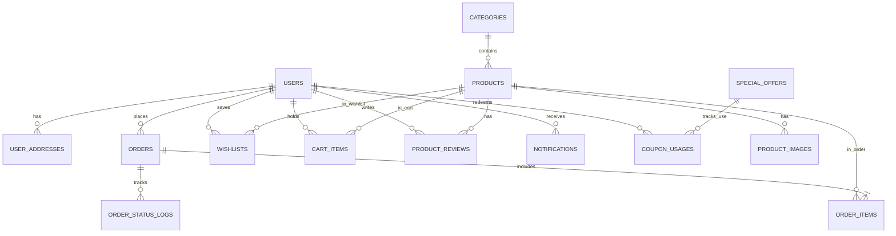

# Food Express - Complete Backend Database Technical Specification

---

## 1. Executive Summary & Architecture Overview

This document provides the complete, production-ready backend database architecture, entity modeling, ER diagram, SQL DDL (PostgreSQL/MySQL), sample data seeding, and API endpoint mappings for **Food Express**.

### System Architecture Diagram



---

## 2. Complete Data Dictionary (14 Entities)

### 2.1 `users`
Customer and admin accounts.

| Field | Data Type | Constraints | Description |
| :--- | :--- | :--- | :--- |
| `id` | UUID | PRIMARY KEY | Unique user ID |
| `name` | VARCHAR(100) | NOT NULL | Full name |
| `email` | VARCHAR(150) | UNIQUE, NOT NULL | Login email address |
| `password_hash` | VARCHAR(255) | NOT NULL | Bcrypt hashed password |
| `phone` | VARCHAR(20) | NULLABLE | Phone number |
| `role` | VARCHAR(20) | DEFAULT 'customer' | `'customer'` or `'admin'` |
| `avatar_url` | VARCHAR(255) | NULLABLE | Avatar URL |
| `created_at` | TIMESTAMP | DEFAULT CURRENT_TIMESTAMP | Registration date |
| `updated_at` | TIMESTAMP | DEFAULT CURRENT_TIMESTAMP | Last updated |

---

### 2.2 `user_addresses`
Saved delivery addresses for fast checkout.

| Field | Data Type | Constraints | Description |
| :--- | :--- | :--- | :--- |
| `id` | UUID | PRIMARY KEY | Address ID |
| `user_id` | UUID | FOREIGN KEY (users.id) | Address owner |
| `address_label` | VARCHAR(50) | DEFAULT 'Home' | Label (e.g. `'Home'`, `'Work'`) |
| `address_line` | TEXT | NOT NULL | Street address |
| `city` | VARCHAR(100) | NOT NULL | City |
| `postal_code` | VARCHAR(20) | NULLABLE | Zip/Postal code |
| `phone` | VARCHAR(20) | NULLABLE | Contact phone |
| `is_default` | BOOLEAN | DEFAULT FALSE | Default address flag |

---

### 2.3 `categories`
Food categories (`burgers`, `pizza`, `drinks`, etc.).

| Field | Data Type | Constraints | Description |
| :--- | :--- | :--- | :--- |
| `id` | VARCHAR(50) | PRIMARY KEY | Category slug ID |
| `name` | VARCHAR(100) | NOT NULL | Display name |
| `icon` | VARCHAR(50) | NOT NULL | Emoji / Icon tag |
| `display_order` | INT | DEFAULT 0 | Ordering priority |
| `is_active` | BOOLEAN | DEFAULT TRUE | Category status |

---

### 2.4 `products`
Menu food items, ratings, and spicy levels.

| Field | Data Type | Constraints | Description |
| :--- | :--- | :--- | :--- |
| `id` | VARCHAR(50) | PRIMARY KEY | Product slug ID |
| `name` | VARCHAR(150) | NOT NULL | Product name |
| `category_id` | VARCHAR(50) | FOREIGN KEY (categories.id) | Category reference |
| `description` | TEXT | NOT NULL | Item description |
| `price` | DECIMAL(10,2) | NOT NULL | Selling price (Rs.) |
| `original_price` | DECIMAL(10,2) | NULLABLE | Strike-through price |
| `rating` | DECIMAL(3,2) | DEFAULT 4.50 | Rating average (0-5) |
| `reviews_count` | INT | DEFAULT 0 | Number of reviews |
| `spicy_level` | INT | DEFAULT 0 | Spicy level (`0` to `4`) |
| `image_url` | TEXT | NOT NULL | Primary main image URL |
| `is_featured` | BOOLEAN | DEFAULT FALSE | Home page feature flag |
| `is_available` | BOOLEAN | DEFAULT TRUE | Stock availability |
| `created_at` | TIMESTAMP | DEFAULT CURRENT_TIMESTAMP | Date created |

---

### 2.5 `product_images` (Gallery Photos)
Multiple gallery image variants per product.

| Field | Data Type | Constraints | Description |
| :--- | :--- | :--- | :--- |
| `id` | BIGSERIAL | PRIMARY KEY | Image record ID |
| `product_id` | VARCHAR(50) | FOREIGN KEY (products.id) | Related food item |
| `image_url` | TEXT | NOT NULL | Gallery image URL |
| `display_order` | INT | DEFAULT 0 | Sort order |

---

### 2.6 `product_reviews`
Customer product reviews and ratings.

| Field | Data Type | Constraints | Description |
| :--- | :--- | :--- | :--- |
| `id` | UUID | PRIMARY KEY | Review ID |
| `product_id` | VARCHAR(50) | FOREIGN KEY (products.id) | Reviewed product |
| `user_id` | UUID | FOREIGN KEY (users.id) | Reviewer user |
| `rating` | INT | NOT NULL | Rating (1-5 stars) |
| `comment` | TEXT | NULLABLE | Written review |
| `created_at` | TIMESTAMP | DEFAULT CURRENT_TIMESTAMP | Date posted |

---

### 2.7 `cart_items` (Persistent Shopping Carts)
Active persistent cart items per user across sessions.

| Field | Data Type | Constraints | Description |
| :--- | :--- | :--- | :--- |
| `user_id` | UUID | FOREIGN KEY (users.id) | Cart owner |
| `product_id` | VARCHAR(50) | FOREIGN KEY (products.id) | Cart food item |
| `quantity` | INT | DEFAULT 1 | Item quantity |
| `updated_at` | TIMESTAMP | DEFAULT CURRENT_TIMESTAMP | Last updated |
| PRIMARY KEY | `(user_id, product_id)` | | Composite Primary Key |

---

### 2.8 `special_offers` (Promotions & Coupons)
Promo code definitions.

| Field | Data Type | Constraints | Description |
| :--- | :--- | :--- | :--- |
| `id` | VARCHAR(50) | PRIMARY KEY | Offer ID |
| `code` | VARCHAR(30) | UNIQUE, NOT NULL | Promo code (e.g. `'FREE15'`) |
| `title` | VARCHAR(100) | NOT NULL | Offer headline |
| `subtitle` | VARCHAR(150) | NULLABLE | Tagline |
| `badge` | VARCHAR(50) | NULLABLE | Badge text |
| `discount_type` | VARCHAR(20) | NOT NULL | `'percentage'`, `'fixed'`, `'free_delivery'` |
| `discount_value` | DECIMAL(10,2) | DEFAULT 0.00 | Value |
| `min_order_amount`| DECIMAL(10,2) | DEFAULT 0.00 | Min subtotal requirement |
| `is_active` | BOOLEAN | DEFAULT TRUE | Promo status |

---

### 2.9 `coupon_usages`
Tracks one-time coupon redemptions to prevent reuse abuse.

| Field | Data Type | Constraints | Description |
| :--- | :--- | :--- | :--- |
| `id` | UUID | PRIMARY KEY | Redemption ID |
| `coupon_id` | VARCHAR(50) | FOREIGN KEY (special_offers.id) | Redeemed coupon |
| `user_id` | UUID | FOREIGN KEY (users.id) | User who redeemed |
| `order_id` | VARCHAR(30) | FOREIGN KEY (orders.id) | Associated order |
| `discount_applied`| DECIMAL(10,2) | NOT NULL | Discount amount saved |
| `used_at` | TIMESTAMP | DEFAULT CURRENT_TIMESTAMP | Redemption date |

---

### 2.10 `orders`
Order headers and delivery information.

| Field | Data Type | Constraints | Description |
| :--- | :--- | :--- | :--- |
| `id` | VARCHAR(30) | PRIMARY KEY | Order ID (e.g., `'#FE-892401'`) |
| `user_id` | UUID | FOREIGN KEY (users.id) | Placed by user (NULL for guest) |
| `customer_name` | VARCHAR(100) | NOT NULL | Recipient name |
| `customer_phone` | VARCHAR(20) | NOT NULL | Recipient phone |
| `customer_email` | VARCHAR(150) | NOT NULL | Recipient email |
| `delivery_address`| TEXT | NOT NULL | Delivery address |
| `city` | VARCHAR(100) | NOT NULL | City |
| `postal_code` | VARCHAR(20) | NULLABLE | Zip code |
| `payment_method` | VARCHAR(20) | NOT NULL | `'cod'` or `'card'` |
| `payment_status` | VARCHAR(20) | DEFAULT 'pending' | `'pending'`, `'paid'`, `'failed'` |
| `order_status` | VARCHAR(20) | DEFAULT 'pending' | `'pending'`, `'preparing'`, `'delivering'`, `'delivered'`, `'cancelled'` |
| `subtotal` | DECIMAL(10,2) | NOT NULL | Subtotal |
| `delivery_fee` | DECIMAL(10,2) | DEFAULT 250.00 | Delivery charge |
| `discount_amount` | DECIMAL(10,2) | DEFAULT 0.00 | Discount deducted |
| `promo_code` | VARCHAR(30) | NULLABLE | Applied promo code |
| `total_amount` | DECIMAL(10,2) | NOT NULL | Final order total |
| `special_notes` | TEXT | NULLABLE | Special instructions |
| `created_at` | TIMESTAMP | DEFAULT CURRENT_TIMESTAMP | Order creation timestamp |

---

### 2.11 `order_items`
Ordered items breakdown.

| Field | Data Type | Constraints | Description |
| :--- | :--- | :--- | :--- |
| `id` | BIGSERIAL | PRIMARY KEY | Line item ID |
| `order_id` | VARCHAR(30) | FOREIGN KEY (orders.id) | Parent order |
| `product_id` | VARCHAR(50) | FOREIGN KEY (products.id) | Ordered product |
| `product_name` | VARCHAR(150) | NOT NULL | Item name snapshot |
| `unit_price` | DECIMAL(10,2) | NOT NULL | Unit price |
| `quantity` | INT | NOT NULL | Quantity |
| `total_price` | DECIMAL(10,2) | NOT NULL | `unit_price * quantity` |

---

### 2.12 `order_status_logs`
Tracks timeline status changes for order tracking view.

| Field | Data Type | Constraints | Description |
| :--- | :--- | :--- | :--- |
| `id` | BIGSERIAL | PRIMARY KEY | Log ID |
| `order_id` | VARCHAR(30) | FOREIGN KEY (orders.id) | Order tracked |
| `status` | VARCHAR(20) | NOT NULL | New status code |
| `notes` | TEXT | NULLABLE | Status update note |
| `created_at` | TIMESTAMP | DEFAULT CURRENT_TIMESTAMP | Timestamp |

---

### 2.13 `wishlists`
Saved customer favorite items.

| Field | Data Type | Constraints | Description |
| :--- | :--- | :--- | :--- |
| `user_id` | UUID | FOREIGN KEY (users.id) | User |
| `product_id` | VARCHAR(50) | FOREIGN KEY (products.id) | Product |
| `created_at` | TIMESTAMP | DEFAULT CURRENT_TIMESTAMP | Timestamp |
| PRIMARY KEY | `(user_id, product_id)` | | Composite Primary Key |

---

### 2.14 `notifications`
System and order notifications.

| Field | Data Type | Constraints | Description |
| :--- | :--- | :--- | :--- |
| `id` | UUID | PRIMARY KEY | Notification ID |
| `user_id` | UUID | FOREIGN KEY (users.id) | Recipient user |
| `title` | VARCHAR(100) | NOT NULL | Notification title |
| `message` | TEXT | NOT NULL | Notification message |
| `is_read` | BOOLEAN | DEFAULT FALSE | Read status |
| `created_at` | TIMESTAMP | DEFAULT CURRENT_TIMESTAMP | Timestamp |

---

## 3. SQL DDL Schema Creation Script (PostgreSQL)

```sql
-- Enable UUID extension
CREATE EXTENSION IF NOT EXISTS "pgcrypto";

-- 1. USERS
CREATE TABLE IF NOT EXISTS users (
    id UUID PRIMARY KEY DEFAULT gen_random_uuid(),
    name VARCHAR(100) NOT NULL,
    email VARCHAR(150) UNIQUE NOT NULL,
    password_hash VARCHAR(255) NOT NULL,
    phone VARCHAR(20),
    role VARCHAR(20) DEFAULT 'customer',
    avatar_url VARCHAR(255),
    created_at TIMESTAMP DEFAULT CURRENT_TIMESTAMP,
    updated_at TIMESTAMP DEFAULT CURRENT_TIMESTAMP
);

-- 2. USER ADDRESSES
CREATE TABLE IF NOT EXISTS user_addresses (
    id UUID PRIMARY KEY DEFAULT gen_random_uuid(),
    user_id UUID REFERENCES users(id) ON DELETE CASCADE,
    address_label VARCHAR(50) DEFAULT 'Home',
    address_line TEXT NOT NULL,
    city VARCHAR(100) NOT NULL,
    postal_code VARCHAR(20),
    phone VARCHAR(20),
    is_default BOOLEAN DEFAULT FALSE
);

-- 3. CATEGORIES
CREATE TABLE IF NOT EXISTS categories (
    id VARCHAR(50) PRIMARY KEY,
    name VARCHAR(100) NOT NULL,
    icon VARCHAR(50) NOT NULL,
    display_order INT DEFAULT 0,
    is_active BOOLEAN DEFAULT TRUE
);

-- 4. PRODUCTS
CREATE TABLE IF NOT EXISTS products (
    id VARCHAR(50) PRIMARY KEY,
    name VARCHAR(150) NOT NULL,
    category_id VARCHAR(50) REFERENCES categories(id) ON DELETE SET NULL,
    description TEXT NOT NULL,
    price DECIMAL(10, 2) NOT NULL,
    original_price DECIMAL(10, 2),
    rating DECIMAL(3, 2) DEFAULT 4.50,
    reviews_count INT DEFAULT 0,
    spicy_level INT DEFAULT 0,
    image_url TEXT NOT NULL,
    is_featured BOOLEAN DEFAULT FALSE,
    is_available BOOLEAN DEFAULT TRUE,
    created_at TIMESTAMP DEFAULT CURRENT_TIMESTAMP
);

-- 5. PRODUCT IMAGES (Gallery)
CREATE TABLE IF NOT EXISTS product_images (
    id BIGSERIAL PRIMARY KEY,
    product_id VARCHAR(50) REFERENCES products(id) ON DELETE CASCADE,
    image_url TEXT NOT NULL,
    display_order INT DEFAULT 0
);

-- 6. PRODUCT REVIEWS
CREATE TABLE IF NOT EXISTS product_reviews (
    id UUID PRIMARY KEY DEFAULT gen_random_uuid(),
    product_id VARCHAR(50) REFERENCES products(id) ON DELETE CASCADE,
    user_id UUID REFERENCES users(id) ON DELETE CASCADE,
    rating INT CHECK (rating >= 1 AND rating <= 5),
    comment TEXT,
    created_at TIMESTAMP DEFAULT CURRENT_TIMESTAMP
);

-- 7. CART ITEMS (Persistent Carts)
CREATE TABLE IF NOT EXISTS cart_items (
    user_id UUID REFERENCES users(id) ON DELETE CASCADE,
    product_id VARCHAR(50) REFERENCES products(id) ON DELETE CASCADE,
    quantity INT DEFAULT 1 CHECK (quantity > 0),
    updated_at TIMESTAMP DEFAULT CURRENT_TIMESTAMP,
    PRIMARY KEY (user_id, product_id)
);

-- 8. SPECIAL OFFERS
CREATE TABLE IF NOT EXISTS special_offers (
    id VARCHAR(50) PRIMARY KEY,
    code VARCHAR(30) UNIQUE NOT NULL,
    title VARCHAR(100) NOT NULL,
    subtitle VARCHAR(150),
    badge VARCHAR(50),
    discount_type VARCHAR(20) NOT NULL,
    discount_value DECIMAL(10, 2) DEFAULT 0.00,
    min_order_amount DECIMAL(10, 2) DEFAULT 0.00,
    is_active BOOLEAN DEFAULT TRUE
);

-- 9. ORDERS
CREATE TABLE IF NOT EXISTS orders (
    id VARCHAR(30) PRIMARY KEY,
    user_id UUID REFERENCES users(id) ON DELETE SET NULL,
    customer_name VARCHAR(100) NOT NULL,
    customer_phone VARCHAR(20) NOT NULL,
    customer_email VARCHAR(150) NOT NULL,
    delivery_address TEXT NOT NULL,
    city VARCHAR(100) NOT NULL,
    postal_code VARCHAR(20),
    payment_method VARCHAR(20) NOT NULL,
    payment_status VARCHAR(20) DEFAULT 'pending',
    order_status VARCHAR(20) DEFAULT 'pending',
    subtotal DECIMAL(10, 2) NOT NULL,
    delivery_fee DECIMAL(10, 2) DEFAULT 250.00,
    discount_amount DECIMAL(10, 2) DEFAULT 0.00,
    promo_code VARCHAR(30),
    total_amount DECIMAL(10, 2) NOT NULL,
    special_notes TEXT,
    created_at TIMESTAMP DEFAULT CURRENT_TIMESTAMP
);

-- 10. ORDER ITEMS
CREATE TABLE IF NOT EXISTS order_items (
    id BIGSERIAL PRIMARY KEY,
    order_id VARCHAR(30) REFERENCES orders(id) ON DELETE CASCADE,
    product_id VARCHAR(50) REFERENCES products(id) ON DELETE SET NULL,
    product_name VARCHAR(150) NOT NULL,
    unit_price DECIMAL(10, 2) NOT NULL,
    quantity INT NOT NULL,
    total_price DECIMAL(10, 2) NOT NULL
);

-- 11. ORDER STATUS LOGS (Tracking Timeline)
CREATE TABLE IF NOT EXISTS order_status_logs (
    id BIGSERIAL PRIMARY KEY,
    order_id VARCHAR(30) REFERENCES orders(id) ON DELETE CASCADE,
    status VARCHAR(20) NOT NULL,
    notes TEXT,
    created_at TIMESTAMP DEFAULT CURRENT_TIMESTAMP
);

-- 12. COUPON USAGES
CREATE TABLE IF NOT EXISTS coupon_usages (
    id UUID PRIMARY KEY DEFAULT gen_random_uuid(),
    coupon_id VARCHAR(50) REFERENCES special_offers(id) ON DELETE CASCADE,
    user_id UUID REFERENCES users(id) ON DELETE CASCADE,
    order_id VARCHAR(30) REFERENCES orders(id) ON DELETE CASCADE,
    discount_applied DECIMAL(10, 2) NOT NULL,
    used_at TIMESTAMP DEFAULT CURRENT_TIMESTAMP
);

-- 13. WISHLISTS
CREATE TABLE IF NOT EXISTS wishlists (
    user_id UUID REFERENCES users(id) ON DELETE CASCADE,
    product_id VARCHAR(50) REFERENCES products(id) ON DELETE CASCADE,
    created_at TIMESTAMP DEFAULT CURRENT_TIMESTAMP,
    PRIMARY KEY (user_id, product_id)
);

-- 14. NOTIFICATIONS
CREATE TABLE IF NOT EXISTS notifications (
    id UUID PRIMARY KEY DEFAULT gen_random_uuid(),
    user_id UUID REFERENCES users(id) ON DELETE CASCADE,
    title VARCHAR(100) NOT NULL,
    message TEXT NOT NULL,
    is_read BOOLEAN DEFAULT FALSE,
    created_at TIMESTAMP DEFAULT CURRENT_TIMESTAMP
);
```

---

## 4. Sample Data Seeding Script

```sql
-- Seed Categories
INSERT INTO categories (id, name, icon, display_order) VALUES
('burgers', 'Burgers', '🍔', 1),
('pizza', 'Pizza', '🍕', 2),
('chicken', 'Chicken', '🍗', 3),
('rice', 'Rice', '🍚', 4),
('sandwich', 'Sandwich', '🥪', 5),
('drinks', 'Drinks', '🥤', 6),
('desserts', 'Desserts', '🧁', 7)
ON CONFLICT (id) DO NOTHING;

-- Seed Products
INSERT INTO products (id, name, category_id, description, price, original_price, rating, reviews_count, spicy_level, image_url, is_featured) VALUES
('chicken-burger', 'Chicken Burger', 'burgers', 'Juicy chicken patty with fresh vegetables', 1490.00, 1950.00, 4.5, 120, 2, 'https://images.unsplash.com/photo-1568901346375-23c9450c58cd?auto=format&fit=crop&w=800&q=80', TRUE),
('beef-burger', 'Beef Burger', 'burgers', 'Grilled beef patty with cheese and special sauce', 1790.00, NULL, 4.6, 98, 2, 'https://images.unsplash.com/photo-1550547660-d9450f859349?auto=format&fit=crop&w=800&q=80', TRUE),
('margherita-pizza', 'Margherita Pizza', 'pizza', 'Classic pizza with fresh tomato and cheese', 2690.00, 3290.00, 4.7, 98, 1, 'https://images.unsplash.com/photo-1604382354936-07c5d9983bd3?auto=format&fit=crop&w=800&q=80', TRUE),
('fried-chicken', 'Fried Chicken', 'chicken', 'Crispy and delicious chicken pieces', 2090.00, NULL, 4.6, 142, 2, 'https://images.unsplash.com/photo-1626645738196-c2a7c87a8f58?auto=format&fit=crop&w=800&q=80', TRUE),
('coca-cola', 'Coca Cola', 'drinks', 'Chilled refreshing drink with ice', 590.00, NULL, 4.3, 89, 0, 'https://images.unsplash.com/photo-1622483767028-3f66f32aef97?auto=format&fit=crop&w=800&q=80', TRUE)
ON CONFLICT (id) DO NOTHING;

-- Seed Promo Offers
INSERT INTO special_offers (id, code, title, subtitle, badge, discount_type, discount_value) VALUES
('free-delivery', 'FREE15', 'FREE DELIVERY', 'On orders over Rs. 4,500', 'FREE DELIVERY', 'free_delivery', 250.00),
('burger-combo', 'BURGER31', 'BURGER COMBO', 'Burger + Fries + Drink', 'BEST DEAL', 'percentage', 20.00)
ON CONFLICT (id) DO NOTHING;
```

---

## 5. API Endpoint SQL Query Mapping

| Method | Route | Description | Query Mapping |
| :--- | :--- | :--- | :--- |
| `POST` | `/api/auth/register` | User Signup | `INSERT INTO users (...) VALUES (...)` |
| `POST` | `/api/auth/login` | User Login | `SELECT * FROM users WHERE email = :email` |
| `GET` | `/api/user/addresses` | List user addresses | `SELECT * FROM user_addresses WHERE user_id = :userId` |
| `POST` | `/api/cart` | Save active cart item | `INSERT INTO cart_items (...) VALUES (...) ON CONFLICT UPDATE` |
| `GET` | `/api/orders/:id/track` | Track order timeline | `SELECT * FROM order_status_logs WHERE order_id = :id ORDER BY created_at ASC` |
| `GET` | `/api/notifications` | User notifications | `SELECT * FROM notifications WHERE user_id = :userId ORDER BY created_at DESC` |
